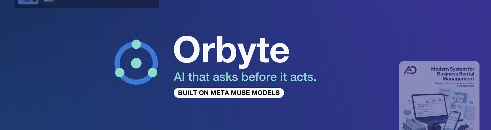
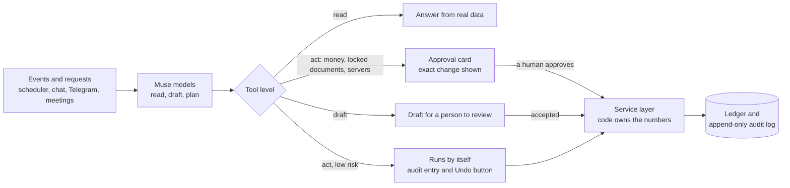
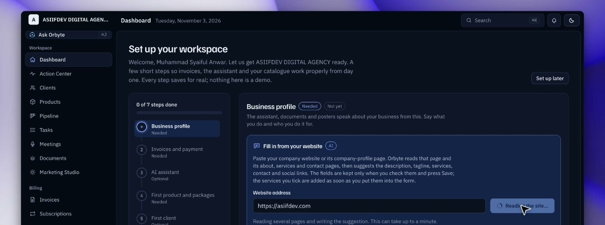
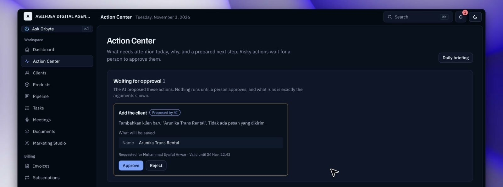
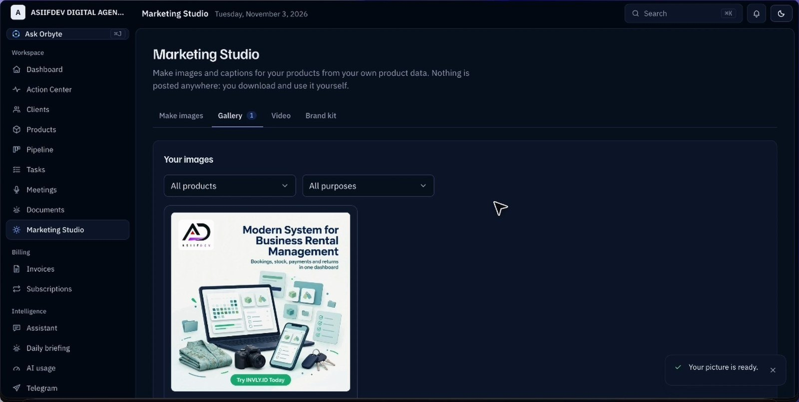
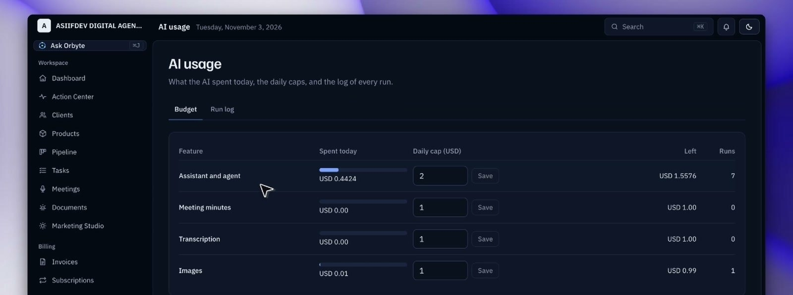
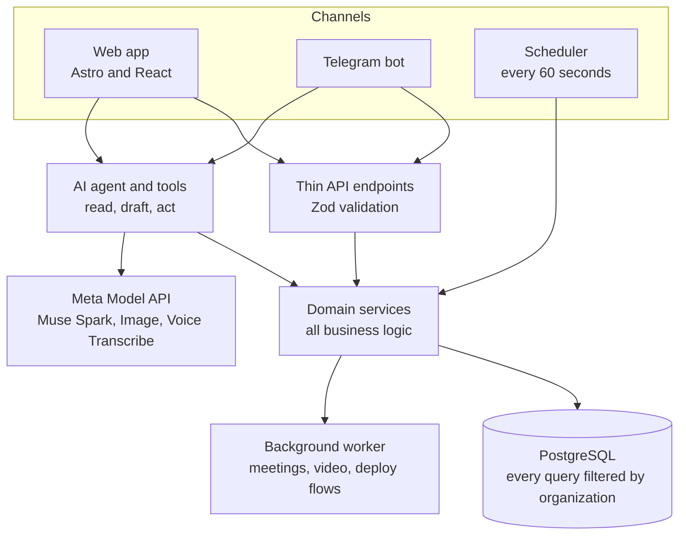

<p align="center">
  
</p>

<h1 align="center">Orbyte</h1>

<p align="center"><b>The AI operations manager that asks before it acts.</b><br>
An AI business operating system for software agencies and startups, built on Meta's Muse models.</p>

<p align="center">
  <a href="https://youtu.be/kVSmhxPLOPg"></a>
  <a href="https://ai-business.asiifdev.com"></a>
  
  
  
  
</p>

<p align="center">
  <a href="#demo">Demo</a> ·
  <a href="#try-it-in-3-minutes">Try it</a> ·
  <a href="#how-it-works">How it works</a> ·
  <a href="#what-makes-it-different">Why it is different</a> ·
  <a href="#features">Features</a> ·
  <a href="#meta-models-used">Meta models</a> ·
  <a href="#architecture">Architecture</a> ·
  <a href="#running-locally">Run it</a> ·
  <a href="#documents">Docs</a>
</p>

Orbyte keeps your clients, products, subscriptions, invoices, leads, tasks, documents, meetings and marketing in one place. An AI built on **Meta's Muse models** does the legwork: it reads, drafts, plans, and prepares actions, while **a person approves everything that matters**. Built for the Meta Global AI Developer Hackathon (Startup track). The repository folder is `business-ai-operation`; the product name is read from one file, `src/config/brand.ts`.

## Demo

<p align="center">
  <a href="https://youtu.be/kVSmhxPLOPg">
    
  </a>
  <br>
  <sub>Click to watch the 2 min 40 s demo on YouTube. Or try the live app: <a href="https://ai-business.asiifdev.com">ai-business.asiifdev.com</a>. All data shown is fake seed data.</sub>
</p>

What the video shows: sign up and let Muse Spark fill in the company profile from a website, one sentence to the assistant that searches the web and prepares a client and a product, human approval in the Action Center, a poster designed by Muse Image, and the AI usage and audit log that record everything.

## Try it in 3 minutes

You do not need an API key. The live app runs on our own Meta Model API key, with a daily budget per feature.

1. Open <https://ai-business.asiifdev.com>, press **Get started** and create an organization. Use any fake company; sign-up takes about a minute.
2. In the setup wizard, paste a company website into **Fill in from your website** and press **Fill in with AI**. Muse Spark reads the site and suggests the company profile. Nothing is saved until you review it.
3. Open **Assistant** and send: *Add the product invly.id with Basic, Pro and Enterprise packages, add Arunika Trans Rental as a client, and draft a proposal for the Pro package.* The assistant searches the web for real pricing, then **Action Center** shows approval cards with the exact change. Approve them.
4. Open **Marketing Studio**, describe a poster, add a web page and press **Make picture**. Muse Image designs it in about 15 to 40 seconds.
5. Open **AI usage** (every model call with tokens and cost) and **Audit log** (every change, who and when).

Other questions to try in the assistant: "Which clients are behind on the product version?", "How much AI budget is left today?", "Is anything waiting for approval?"

Prefer a local run with fake demo data? See [Running locally](#running-locally): `pnpm db:seed` creates demo organizations and logins.

## How it works



The model proposes, a person decides, and plain code makes the change. The model never edits amounts, dates or statuses.

## Screens from the demo

| | |
|---|---|
| <br><sub><b>Fill in with AI.</b> Muse Spark reads the website and suggests the company profile. Nothing is saved until you review it.</sub> | <br><sub><b>Action Center.</b> The assistant's proposal waits as a card with the exact change shown. A person presses Approve.</sub> |
| <br><sub><b>Marketing Studio.</b> Muse Image designs the poster from a request, a web page and the company logo. It is labeled AI-made.</sub> | <br><sub><b>AI usage.</b> Every model call is logged, with a daily cap per feature.</sub> |

## What makes it different

- **AI is the engine, not a chat window.** The assistant calls typed tools against your real data, searches the web, reads websites, PDFs, images, video and audio, and prepares changes. The system also works without being asked: a scheduler finds overdue invoices, upcoming renewals and late tasks, and the AI explains each finding and drafts the next step.
- **A person decides what matters.** Every tool has one of three levels: `read` (free), `draft` (creates a draft), or `act` (recorded as an approval). Anything involving money, locked documents or servers always waits for a human click. Low-risk actions follow the organization's autonomy level and keep an audit entry and an Undo button.
- **Numbers belong to code, not the model.** Amounts, taxes, due dates, totals and payment status are computed and changed only by services, the scheduler or manual verification. Money is an integer number of Rupiah, never a float. Balances come from an append-only ledger. AI text that contains a number the data does not contain is discarded.
- **Not a generic chatbot.** The assistant talks about the organization's business only. Facts and figures come from tool results; anything outside the business gets a fixed refusal.
- **Everything is traceable and capped.** Every model call is logged with tokens and cost under a daily budget per feature, and every change is written to an append-only audit log enforced by the database.
- **Safe by construction.** Tenant isolation is in code (every query filters by organization), not in the prompt. The text of documents, emails, chats, recordings and web pages is treated as data, never as instructions, so an `act` tool cannot be triggered by untrusted text.
- **Multimodal on Meta models.** Text and tool calling, structured output, vision and video input (Muse Spark), image generation and editing with reference images (Muse Image), batch and real-time speech to text (Muse Voice Transcribe).

## Features

### Assistant (chat-first, on every page)

- Chat page plus a side panel on every screen ("Ask Orbyte", `Ctrl/Cmd+J`), a question bar on the dashboard, and a command palette (`Ctrl/Cmd+K`).
- **Tools for every module** (more than 80): read tools for clients, products, packages, deployments, invoices, subscriptions, leads, tasks, documents, meetings, marketing assets, connections, flows, findings, briefings and AI usage; draft tools for invoices, proposals, tasks, leads, marketing captions and deploy flows; act tools that create or change records (clients, products, packages, subscriptions, deployments, lead stages, conversions, and so on) through approvals.
- **Real progress, not a spinner:** the answer streams the real steps (which tool is running) as they happen.
- **Attachments:** PDF, images, video, audio, Word, Excel, PowerPoint, plain text, and links. Files are uploaded first and read once the message is sent.
- **Web research:** `search_web` finds prospects, competitors and prices; `read_website` reads a whole site from its base address (including JavaScript sites). Queries that contain emails or phone numbers are refused.
- **Bulk input:** create many clients from one message or from a photo.
- **Voice input** (dictation), saved conversation history with search, export, follow-up suggestions, "Open" links to the records it mentions, and a draft that survives a reload.
- **Autonomy levels** per organization: Careful (everything waits for approval), Balanced (low-risk changes run alone, with Undo), Autonomous (also bigger changes; some actions say "cannot be undone in one tap").
- **Errors explained:** form errors have an "Ask Orbyte why" link, and the assistant asks follow-up questions when something is ambiguous (for example a duplicate client name).

### Action Center and daily briefing

- **Findings made by rules, explained by AI:** overdue invoice, renewal draft ready, renewal upcoming, late task, outdated or unreachable deployment. Each is created once per event (idempotent), with amounts read straight from the ledger and priority from a fixed formula.
- Each finding gets an AI explanation and a **drafted message**, with facts fetched through a strict tool so the model cannot invent numbers. Statuses: New, Handled, Ignored, Snoozed, Done (the system closes a finding itself when the cause is gone).
- **Approvals:** proposals appear as cards with the exact arguments ("the action runs now, exactly as shown"). One decision wins whether it is made on the web or in Telegram, permissions and data are re-checked at decision time, and old approvals expire.
- **Daily briefing:** numbers come from the dashboard service; the AI narrative is dropped if its numbers do not match.
- Bell icon and sidebar badges show what needs attention.

### Onboarding and company profile

- Multi-step setup wizard: business profile, invoices and payment, AI assistant autonomy, first product and packages, first client, team, Telegram.
- **Fill in with AI:** paste your website and Muse Spark reads it and suggests the description, tagline, industry, services, contacts and social links. Nothing is saved until you review it and press Save.
- Company profile page: logo, tagline, about, industry, website, contact, social links, customers, strengths, services, and "how to say the company name" (used by the narrator). The AI uses this profile as context in the assistant, Marketing Studio and video scripts.
- Readiness card on the dashboard shows which setup steps are done.

### Portfolio: products, packages, clients, deployments

- Products with logo, version (from the latest release, tag or commit of a GitHub repository), packages with prices, archive or delete rules.
- Clients with a 360-degree view: deployments, subscriptions, invoices, tasks, leads and change history. Clients can also be created from inside any form.
- Deployments per client and product, with uptime and drift checks (see Connections).
- Data tables with search, sort, paging and state kept in the URL.

### Billing: subscriptions, invoices, payments

- Subscriptions with terms and renewal dates; the scheduler creates **renewal invoice drafts idempotently**.
- Invoices with numbered sequences, line items, tax, and a **PDF** export. Content is locked after sending; cancel and correction are recorded, never edited in place.
- **Payments as an append-only ledger** with corrections; overdue and balance are derived values.
- Finance summary and calendar feed the dashboard; staff do not see money.

### Pipeline and tasks

- Lead board with drag-and-drop and buttons; stage transitions with required loss reason, assignee, archive, reopen, stale-lead detection and pipeline value.
- **Convert a lead** to a client with an onboarding checklist; when a final proposal exists, a subscription and the first invoice draft are created from the chosen package.
- Tasks in list and board views, with default due dates, derived "late" state, links to related records, and **similar-task suggestions without embeddings**. Staff see their own tasks. AI creates task and lead drafts that you accept or discard.

### Documents

- Proposals and quotations drafted from official package prices, with totals from the calculation service and an AI narrative that cannot change the numbers.
- Finalize with numbering per type and year, revise as a new version, delete drafts, PDF export. Final documents cannot be edited, even through the database.
- Linked from leads and meetings; meeting minutes are stored as documents.

### Meetings

- **Upload a recording** (or send a long voice note to Telegram): ffmpeg converts and chunks it, Muse Voice Transcribe transcribes each chunk with speaker separation, and Muse Spark writes minutes with structured output.
- **Draft tasks and leads with citations** that are checked against the transcript before they are shown.
- **Live meetings:** real-time captions over a WebSocket relay to Muse Voice Transcribe, then the same transcript, minutes and drafts.
- A proposal made from a meeting carries the meeting it came from.

### Marketing Studio

- **Make pictures:** describe what you want, attach a logo or screenshot, or give a web page link; Muse Image produces a ready-to-post picture (square, portrait or wide), with revisions in plain words (a revision is a new image; the old one stays).
- **Posters with text drawn by code:** the AI writes the headline and call to action from facts (anything with a price or number outside the data is dropped), then code draws the text with an embedded font, so the picture cannot invent a price. Five layouts (gradient, centered, card, ribbon, side) can be changed without calling the AI again.
- **Captions** written by Muse Spark and discarded if they contain numbers outside the product data.
- **Video scripts** (15, 30 or 60 seconds) and **narrated slideshow videos**: one Muse Image per scene, on-screen text drawn by code, speech from a local voice engine, assembled by ffmpeg into MP4. A checker transcribes each scene with Muse Voice Transcribe and re-records it if words are repeated.
- Brand kit, gallery with download, daily image quota per organization (configurable by the owner), AI budget check before every call. Everything is labeled **AI-made** in the UI, the file and its metadata.
- Telegram: send a photo with a caption, or ask in chat, to get a picture.

### Telegram assistant

- Pair your account with a one-time code. Commands: `/status`, `/overdue`, `/tugas` (tasks), `/rapat` (meeting recording), `/bantuan` (help), `/putus` (disconnect), plus free questions to the assistant.
- **Interactive cards with buttons:** findings and approvals (Approve, Reject, Details) go through the same decision service as the web.
- Photos are judged by Muse Spark (vision plus structured output) to decide whether you want a picture made or the image read as context. Documents, video and audio can be read; voice notes are answered as conversation. Conversation history is stored so a server restart does not lose context.
- Webhook with a secret and update de-duplication; notifications are sent every minute by the scheduler.

### Connections and deployment operations

- **Connections:** GitHub App (one-click install with ownership verification), SSH (password, key or both, with host-key pinning before any credential is sent), and aaPanel. Secrets are encrypted at rest (AES-256-GCM bound to organization and connection); private-address (SSRF) guards, rate limits and key rotation are built in.
- **Flow editor:** a visual diagram editor (React Flow) for deploy flows, with a catalogue of 25 tools (GitHub, SSH, aaPanel, Orbyte), validation (cycles, variables, slots), versions that cannot be changed, and templates (for example Laravel plus pm2, setup and update).
- **Runs:** plan, then approval, then execution with live node status, pause on failure, retry without repeating finished steps, cancel. Run secrets are encrypted and deleted when the run ends. The assistant can draft flows (marked "AI-assisted") but may never write free shell commands.
- **Uptime and drift checks** on schedule; findings appear in the Action Center.

### Dashboard and metrics

- One source of numbers (`getBusinessSummary`): recurring revenue, unpaid, overdue, pipeline value, clients with active subscriptions, open and late tasks. The dashboard, briefing, Telegram `/status` and the assistant tool all show the same figures.
- Received vs invoiced chart, deployment composition, operational calendar, "waiting for action" list, AI spend today and latest changes.

### AI usage and budget

- Run log of every model call (feature, person, status, tokens, cost, tools used) and a budget tab with daily caps per feature. When a budget is exhausted, calls are blocked with a clear message.

### Audit log and guardrails

- Append-only audit trail (who, what, when), enforced by database guards; filters by actor, entity and date in the organization's time zone; timelines on products, leads, tasks, documents and meetings.
- Idempotency for automations (the same event never creates a second invoice or message), atomic approval decisions, and expiry of old approvals.

### Users, roles and organization settings

- Roles: **Owner, Admin, Staff**, with a permission matrix. Admins cannot touch the Owner, and nobody can change their own role.
- Invite users by email link (Resend), sign up and sign in, profile and password, language (Indonesian and English), light and dark themes.
- Organization settings: time zone, tax, invoice format, scheduler hour, approval expiry, autonomy level, daily AI limits.

### Marketing site and design system

- Public site in English and Indonesian (17 pages) with SEO, structured data, `llms.txt`, a pricing page and a feature list that is checked against `docs/PLAN.md` so it never promises more than exists.
- Own design system and component library in React (forms, data tables, modals, toasts, tabs, steps, dropdowns, command palette), responsive down to phone size, with a component gallery at `/dev/komponen` in development.

## By the numbers

All figures were checked against this repository on 5 Nov 2026.

| What | Value |
|---|---|
| Automated tests | **1,556 passing** in 133 files (unit, service and database integration); the full run takes about 35 seconds |
| Typed AI tools | **86** (read, draft and act) |
| Domain modules | 26, behind 131 API route files and 46 pages |
| Database migrations | 29 |
| Design decisions written down | 99, in [`docs/DECISIONS.md`](docs/DECISIONS.md) |
| Commits | 63, from 28 Oct to 4 Nov 2026 |
| Cost of an assistant run | **USD 0.02 to 0.14** per run in the demo's AI usage log (about 3,000 to 110,000 tokens, depending on how many tools it calls) |

## Meta models used

| Capability | Model | Used for |
|---|---|---|
| Text, tool calling, structured output, vision and video input | Muse Spark (`muse-spark-1.3`) | Assistant and tools, website reading, explanations and drafts, minutes, captions, scripts, photo triage |
| Image generation and editing with reference images | Muse Image (`muse-image-1.0`) | Marketing pictures, posters, video scenes |
| Speech to text (batch and real time) | Muse Voice Transcribe (`muse-voice-transcribe-1.0`) | Meetings, live captions, dictation, narration checks |

Meta has no text-to-speech, embeddings or video generation. Narration for videos comes from a replaceable local voice engine behind an interface, and the rest of the stack stays behind an `AiProvider` interface.

## Architecture



- **Astro + React** (islands), Tailwind CSS v4, Node adapter; **PostgreSQL** with Drizzle ORM and Better Auth.
- Layers: UI (`src/pages`, `src/components`) calls thin endpoints (`src/pages/api`, Zod validation), which call services (`src/domain/<module>/service.ts`) that hold all business logic. The web, Telegram and the AI tools all call the same services, so numbers never differ between channels.
- A background worker in the server process handles meeting processing, video rendering and deploy flows; a scheduler ticks every 60 seconds.
- 16 module BRDs, a PRD and an ERD drive the schema; migrations come only from the ERD.

## Built during the hackathon

Everything in this repository was written between **28 Oct and 4 Nov 2026**; the first commit is dated 28 Oct. The git history is the record (63 commits). A summary by day:

| Date | What was built |
|---|---|
| 28 Oct | Project scaffold and form component library; BRD, PRD and ERD; authentication and multi-tenancy; AI core (provider layer, tool registry, agent loop, budgets, run log); grounded web assistant; portfolio; billing (invoices, subscriptions); Action Center; pipeline and tasks; landing site |
| 29 Oct | Meetings with audio processing and live speech transcription; documents and proposals; SSH and aaPanel connections; Marketing Studio (posters, brand kit, captions); audit timelines |
| 30 to 31 Oct | Assistant upgrades (attachments, website reading, streaming progress, autonomy levels, conversation history); company profile; narrated video projects; data tables |
| 1 Nov | Daily image quota; deploy flow editor with AI assistance; dictation and chat export; client and product management tools |
| 2 to 3 Nov | Lead documents and conversion to a subscription; onboarding wizard with Fill in with AI; user invitations by email; role-change guard; demo data seed |
| 4 Nov | Onboarding polish, README and submission assets |

How it was built: the author directed and reviewed the work with an AI coding assistant (Claude Code); the development guidance skills are in `.claude/skills/`. Nothing was copied from earlier projects. At runtime, the AI in the product is Meta's Muse models only.

## Honest limits

Some features are verified only in part (for example the Telegram bot with a real account, microphone capture for live meetings in a real browser, and deploy flows against a real server). Per-feature test status lives in [`docs/PLAN.md`](docs/PLAN.md) and is not copied here. All data in the repository and the demo is fake seed data.

**Current status and schedule: [`docs/PLAN.md`](docs/PLAN.md)** (the single source of status; this README does not copy it). Read [`CLAUDE.md`](CLAUDE.md) before working on the code.

## Documents

The project documents are written in Indonesian.

| Document | Contents |
|---|---|
| [`CLAUDE.md`](CLAUDE.md) | Mandatory working guide (document flow, two-track work, Definition of Done, technical rules, skills) |
| [`docs/PLAN.md`](docs/PLAN.md) | Stage and implementation status, schedule, module owners, open questions |
| [`docs/DECISIONS.md`](docs/DECISIONS.md) | Decision log |
| [`docs/00-visi-produk.md`](docs/00-visi-produk.md) | Vision, problem, AI principles, demo story |
| [`docs/01-aturan-hackathon.md`](docs/01-aturan-hackathon.md) | Hackathon rules, schedule, judging |
| [`docs/02-meta-model-api.md`](docs/02-meta-model-api.md) | Meta models, pricing, limits, real test results |
| [`docs/03-arsitektur.md`](docs/03-arsitektur.md) | Stack, structure, layers, AI, Telegram, security |
| [`docs/04-workflow-pengembangan.md`](docs/04-workflow-pengembangan.md) | Two-track work, git, testing |
| [`docs/05-uiux-dan-komponen.md`](docs/05-uiux-dan-komponen.md) | Design system and form component contracts |
| [`docs/09-breakdown-fitur.md`](docs/09-breakdown-fitur.md) | Modules and how they connect |
| [`docs/BRD.md`](docs/BRD.md) | Parent BRD: goals, actors, cross-module rules (CR), glossary, template |
| [`docs/brd/README.md`](docs/brd/README.md) | Index of the per-module BRDs (one file per module) |
| [`docs/PRD.md`](docs/PRD.md) | Product requirements: pages, services, AI and Telegram contracts, testing |
| [`docs/ERD.md`](docs/ERD.md) | Data schema, constraints, database guards, migration plan |

## Running locally

Prerequisites: Node >= 22.23.4, pnpm, PostgreSQL, `ffmpeg`.

```bash
cp .env.example .env     # fill in the values; never commit this file
pnpm install
pnpm db:migrate          # create the tables in the local database
pnpm db:seed             # fake demo data: Orbit Studio and Kopi Senja Digital
pnpm dev                 # component gallery: /dev/komponen
pnpm test                # unit, component, and documentation sync checks
pnpm typecheck
pnpm build
```

The database schema and migrations come only from `docs/ERD.md` (see `CLAUDE.md`).

Sign in with the (fake) demo data after `pnpm db:seed`: `owner@orbit-studio.test`, `admin@orbit-studio.test`, or `staf@orbit-studio.test`, password `demo-password-123`. Test the assistant with `pnpm ai:smoke` (requires `MODEL_API_KEY`).

Meetings (`/app/rapat`): recordings are stored in `STORAGE_DIR` (`disk` driver) and processed by a worker inside the server process. Audio conversion uses `ffmpeg` from PATH or `FFMPEG_PATH`; without ffmpeg, only mono 16/24 kHz WAV files of 9 minutes or less can be processed.

Telegram bot (requires `TELEGRAM_BOT_TOKEN` and `TELEGRAM_WEBHOOK_SECRET`): link your account at `/app/settings/telegram`. Without a public HTTPS address, run `pnpm bot:dev` (long polling). **Caution:** that command deletes the webhook, so the live server stops receiving updates until `pnpm bot:webhook` is run there again.

## Deploying to a server

A public server **must run the production build**, not `pnpm dev` (dev mode exposes the component gallery and development tools, is slower, and rejects any host other than localhost).

```bash
pnpm install --frozen-lockfile
pnpm db:migrate          # review new migrations in drizzle/ before applying them
pnpm build
pnpm start               # listens on HOST:PORT from .env
pnpm bot:webhook         # once per deploy: registers the Telegram webhook and command menu
```

Required variables on the server (never put their values in the repo): `DATABASE_URL`, `BETTER_AUTH_SECRET` (random, at least 32 characters, **different** from your local one), `BETTER_AUTH_URL` and `APP_URL` (the public `https://` address), `HOST`, `PORT`.

The billing scheduler runs in the same process: it ticks every 60 seconds and runs once a day per organization at that organization's scheduler hour, and Telegram cards go out every minute when `TELEGRAM_BOT_TOKEN` is set. Set `SCHEDULER=off` on any process that must not run jobs.

Run `pnpm start` under a process manager (pm2 or systemd) behind an HTTPS proxy that forwards the `Host`, `X-Forwarded-Host`, and `X-Forwarded-Proto` headers. `APP_URL` is read during `pnpm build`, so set it before building.

## Contributors and provenance

- **Author:** one approved hackathon participant (the repository owner).
- **Built from scratch during the hackathon period** (starting 28 Oct 2026). No code was copied from other projects; common design patterns (form component contracts, agent patterns) were rewritten here.
- **Third-party tooling** in `.claude/skills/` (`hallmark`, `tailwind-4-docs`) consists of development guidance skills, not part of the product, each with its own license.
- All demo data is fake seed data; the repo contains no client data, API keys, or credentials.
