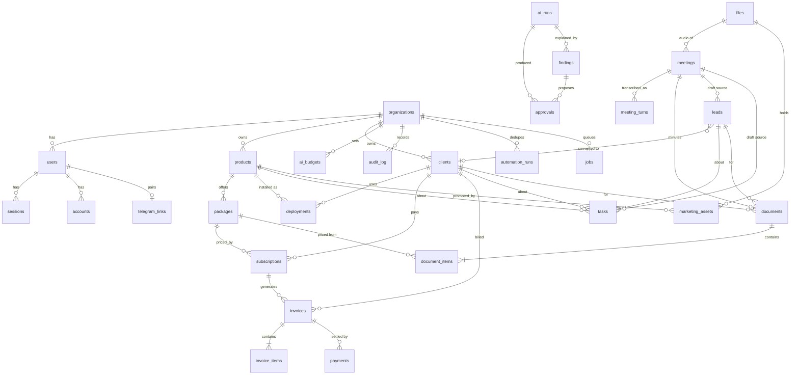

# Entity Relationship Document (ERD)

| | |
|---|---|
| **Status** | ✅ Disetujui owner (2026-10-28), v0.1.0 |
| **Tanggal** | 2026-10-28 |
| **Dasar** | BRD (disetujui), PRD v0.1.0, `docs/DECISIONS.md` |
| **Menggantikan** | draf skema lama yang dihapus (D-006). **Belum ada skema, tabel, atau migrasi di kode** sampai ERD ini disetujui |
| **Target** | PostgreSQL 17, Drizzle ORM (`pg-core`), migrasi lewat `drizzle-kit` |

> ERD menjawab **"data apa disimpan dan bagaimana dijaga"**. Aturan bisnis tidak diulang; kolom dan batasan merujuk ID aturan (`BR-Mxx-nn`, `CR-nn`). Kondisi **turunan** (lewat jatuh tempo, tertinggal versi, terlambat, stagnan, outstanding, MRR) **tidak punya kolom** (CR-01). Item ⚠️ menunggu keputusan owner.

## 1. Konvensi

| Topik | Aturan |
|---|---|
| **ID** | `text` berisi **ULID** (26 karakter, terurut waktu), dibuat aplikasi (`$defaultFn`). Alasan: ringkas untuk `callback_data` Telegram (batas 64 byte, PRD §6) dan aman dipamerkan. Tabel milik Better Auth memakai ID bawaannya (`text`); kolom yang merujuknya bertipe `text` juga |
| **Uang** | `bigint` (mode `number`) **Rupiah utuh**. Bukan `integer`: nilai 32-bit hanya sampai ±2,1 miliar dan tagihan agensi dapat melebihinya. Tidak ada `numeric`/`float` untuk uang (CR-04) |
| **Pajak** | `integer` **basis poin** (1100 = 11%); default 0 (BR-M03-17) |
| **Biaya AI** | `bigint` **mikro-USD** (1 USD = 1.000.000) agar tidak memakai float |
| **Waktu** | `timestamptz` untuk kejadian; `date` untuk tanggal bisnis (jatuh tempo, tanggal bayar) yang dimaknai di zona waktu organisasi |
| **Tenant** | Setiap tabel bisnis punya `org_id text not null` → `organizations.id` |
| **Isolasi di DB** | Setiap tabel induk punya `UNIQUE (org_id, id)`, dan setiap relasi anak memakai **foreign key komposit** `(org_id, parent_id) → induk(org_id, id)`. Akibatnya baris org A **tidak mungkin** menunjuk baris org B walau ada bug aplikasi (D-011) |
| **Hapus** | Tidak ada hard delete untuk data bertagihan. Pengganti: kolom `archived_at timestamptz` (BR-M02-08). Hard delete hanya untuk berkas rekaman atas permintaan pengguna (M09) |
| **Enum** | `pgEnum` dengan **kode Inggris snake_case**; label Indonesia/Inggris hanya di kamus i18n (glosarium BRD tetap acuan UI). Menambah nilai = migrasi baru |
| **Pelaku** | Kolom `actor text` berformat `user:<id>` \| `ai:<run_id>` \| `system:<rule>` (BR-M15-02) |
| **Cap waktu** | Semua tabel: `created_at timestamptz default now()`; yang dapat berubah juga `updated_at` |
| **Nama** | tabel `snake_case` jamak, kolom `snake_case`, indeks `idx_<tabel>_<kolom>`, unik `uq_<tabel>_<kolom>` |
| **Berkas skema** | `src/db/schema/<domain>.ts` per kelompok di §4; satu `index.ts` mengekspor semuanya |

### 1.1 Kode enum

| Enum | Nilai (kode → label UI) |
|---|---|
| `user_role` | `owner` Pemilik · `admin` Admin · `staff` Staf |
| `invoice_status` | `draft` Draft · `sent` Terkirim · `paid` Lunas · `void` Batal |
| `subscription_status` | `active` Aktif · `stopped` Berhenti |
| `payment_kind` | `payment` Pembayaran · `correction` Koreksi |
| `lead_stage` | `new` Baru · `exploring` Penjajakan · `proposal` Proposal · `negotiation` Negosiasi · `won` Menang · `lost` Kalah |
| `task_kind` | `task` Tugas · `bug` Bug · `feature` Fitur · `maintenance` Maintenance |
| `task_status` | `open` Terbuka · `in_progress` Dikerjakan · `done` Selesai |
| `task_priority` | `low` · `medium` · `high` · `urgent` |
| `document_kind` | `proposal` · `quotation` · `minutes` |
| `document_status` | `draft` · `final` |
| `approval_status` | `pending` Menunggu · `approved` Disetujui · `rejected` Ditolak · `expired` Kedaluwarsa |
| `finding_status` | `new` Baru · `handled` Ditangani · `ignored` Diabaikan · `snoozed` Ditunda · `auto_resolved` Selesai sendiri |
| `finding_rule` | `invoice_overdue` · `invoice_draft_ready` · `renewal_upcoming` · `task_late` · `lead_stagnant` · `deployment_outdated` · `deployment_down` |
| `ai_feature` | `agent` · `minutes` · `transcribe` · `image` |
| `ai_run_status` | `ok` · `error` · `blocked_budget` · `rejected_tool` |
| `job_status` | `queued` · `running` · `done` · `failed` |
| `meeting_status` | `uploaded` · `processing` · `done` · `failed` |
| `file_kind` | `meeting_audio` · `marketing_image` · `product_logo` · `brand_logo` |
| `marketing_purpose` | `launch` · `promo` · `education` · `release` · `brand` (D-066) · `free` (D-080: gambar dari permintaan bebas, bukan dari pilihan tujuan) |
| `deployment_status` | `active` · `inactive` |
| `connection_kind` | `github` · `ssh` · `aapanel` (CyberPanel dan cPanel ditambahkan lewat migrasi saat didukung, D-055) |
| `connection_test` | `untested` · `ok` · `failed` |
| `setup_mode` | `branch_per_client` · `shared_branch` |
| `run_kind` | `setup` · `update` |
| `run_status` | `planned` · `awaiting_approval` · `running` · `paused` · `done` · `failed` · `cancelled` |
| `step_status` | `pending` · `running` · `done` · `failed` · `skipped` |
| `uptime_state` | `up` · `down` |

## 2. Diagram

## 3. Tabel per kelompok

Tipe `ref` = foreign key komposit ke `(org_id, id)` tabel induk (kecuali disebut lain). **N** = boleh NULL.

### 3.1 Organisasi dan identitas (M01)

**`organizations`** · BR-M01-07

| Kolom | Tipe | Aturan |
|---|---|---|
| `id` | text PK | ULID |
| `name` | text | wajib |
| `currency` | text | default `IDR` (satu-satunya nilai di MVP) |
| `timezone` | text | default `Asia/Jakarta` |
| `locale` | text | default bahasa organisasi (`id`/`en`) |
| `grace_days` | smallint | default 7 (BR-M03-11) |
| `draft_offset_days` | smallint | default 7, draf invoice dibuat H-n |
| `scheduler_hour` | smallint | default 8, jam rule harian (0–23) |
| `briefing_hour` | smallint | default 8 |
| `uptime_interval_min` | smallint | default 5, interval cek uptime (M17, D-055) |
| `step_timeout_sec` | integer | default 300, batas waktu satu langkah run (M17, D-055) |
| `code_check_interval_min` | smallint | default 30, interval cek kode terpasang (M17, D-055) |
| `invoice_number_format` | text | default `INV-{YYYY}-{NNNN}` |
| `tax_rate_bps` | integer | default 0 |
| `stagnant_days` | smallint | default 14 (D-025) |
| `approval_ttl_hours` | smallint | default 24 (D-025) |
| `bank_name`, `bank_account_name`, `bank_account_number` | text N | info pembayaran di PDF (BR-M03-15) |
| `created_at`, `updated_at` | timestamptz | |

Batasan: `CHECK` rentang jam 0–23, hari ≥ 0, `tax_rate_bps` 0–10000.

**`users`** (tabel `user` milik Better Auth dipetakan ke `users`, D-009) · BR-M01-02, -03, -06

| Kolom | Tipe | Aturan |
|---|---|---|
| `id` | text PK | ID bawaan Better Auth |
| `org_id` | text → `organizations.id` | wajib; **satu pengguna satu organisasi** |
| `name`, `email` | text | `email` unik **tak peka huruf** (`UNIQUE (lower(email))`) |
| `email_verified` | boolean | bawaan Better Auth |
| `image` | text N | bawaan |
| `role` | `user_role` | `additionalFields`, `input:false` (tidak dapat diisi klien) |
| `locale` | text | `id`/`en`, preferensi UI dan bot (D-013) |
| `is_active` | boolean | default true; false mencabut sesi seketika (BR-M01-06) |
| `must_change_password` | boolean | true untuk pengguna yang dibuat Pemilik/Admin |
| `created_at`, `updated_at` | timestamptz | |

Batasan: `UNIQUE (org_id, id)` (untuk FK komposit). Penjaga Pemilik terakhir di layanan **dan** dibantu pemicu DB (§5).

**`sessions`, `accounts`, `verifications`**: dibuat dengan `npx auth@latest generate` (Better Auth) lalu digabung ke skema. `accounts.password` menyimpan **hash** kata sandi (BR-M01-05); tidak pernah di log. Tidak diedit tangan; perubahan lewat konfigurasi Better Auth.

**`telegram_links`** · BR-M11, BR-M01-08

| Kolom | Tipe | Aturan |
|---|---|---|
| `id` | text PK | |
| `org_id`, `user_id` | text | ref `users` |
| `chat_id` | bigint | unik **di antara tautan aktif** (`WHERE unlinked_at IS NULL`); satu chat hanya satu pengguna pada satu waktu, dan boleh dihubungkan ulang setelah `/putus` |
| `username` | text N | |
| `linked_at` | timestamptz | |
| `unlinked_at` | timestamptz N | `/putus`; baris aktif = `unlinked_at IS NULL` |

Unik parsial: `UNIQUE (user_id) WHERE unlinked_at IS NULL`.

**`telegram_pairing_codes`**: `id`, `org_id`, `user_id`, `code_hash text` (hash, bukan kode asli), `expires_at` (10 menit), `used_at N`. Indeks `code_hash`.

**`telegram_updates`**: `update_id bigint PK`, `received_at`. Menolak pemrosesan ganda saat Telegram mengirim ulang webhook (idempotensi).

**`organization_profiles`** (D-079): satu baris per organisasi (`org_id` **`UNIQUE`**), dibuat saat pertama disimpan. Profil perusahaan sebagai **sumber tunggal** identitas bisnis, dipakai tampilan (logo di poster) dan menjadi **konteks AI** (asisten, Marketing Studio, naskah video). Tidak memuat angka keuangan.

| Kolom | Tipe | Aturan |
|---|---|---|
| `id` | text PK | ULID |
| `org_id` | text | FK `organizations`, UNIQUE |
| `tagline` | text N | maks 160 |
| `description` | text N | tentang perusahaan, maks 2000 |
| `industry` | text N | bidang usaha, maks 120 |
| `website` | text N | alamat web `https://…`, maks 300 |
| `contact_email`, `contact_phone`, `address` | text N | kontak publik, maks 254/40/500 |
| `socials` | jsonb | peta `instagram`, `facebook`, `linkedin`, `tiktok`, `youtube`, `x` ke URL `https://…`; kunci lain ditolak |
| `target_audience` | text N | siapa pelanggannya, maks 1000 |
| `value_props` | text N | keunggulan dan pembeda, maks 1000 |
| `logo_file_id` | text N | ref `files` dengan `kind = brand_logo` (komposit `org_id, logo_file_id`). **Menggantikan `brand_kits.logo_file_id`**: kolom lama dibiarkan (tidak dipakai lagi), isinya disalin ke sini saat migrasi |
| `created_at`, `updated_at` | timestamptz | |

**`org_services`** (D-079): layanan atau jasa yang ditawarkan **di luar produk** Portfolio (produk dan paket resmi tetap dari M02, tidak diduplikasi di sini). `id`, `org_id`, `name` (wajib, maks 120, unik per organisasi tanpa membedakan huruf besar), `description text N` (maks 600), `sort_order smallint` (default 0), `created_at`, `updated_at`.

### 3.2 Portofolio (M02)

**`products`** · BR-M02-01, -02, -05, -06

`id`, `org_id`, `name` (wajib), `description N`, `current_version text N`, `logo_file_id N` (ref `files` dengan `kind = product_logo`; D-065), `archived_at N`, timestamps. `UNIQUE (org_id, id)`, `UNIQUE (org_id, lower(name)) WHERE archived_at IS NULL`.

**`packages`** (paket dan harga resmi, **satu-satunya sumber harga**, CR-05)

`id`, `org_id`, `product_id` (ref `products`), `name`, `monthly_price bigint` (`CHECK ≥ 0`), `features text N` (daftar fitur ringkas), `archived_at N`, timestamps. `UNIQUE (org_id, id)`, `UNIQUE (product_id, lower(name))`.

**`clients`** · BR-M02-10

`id`, `org_id`, `name`, `name_key text` (nama ternormalisasi: huruf kecil, spasi dirapikan), `contact_name N`, `email N`, `phone N`, `address N`, `notes N`, `archived_at N`, timestamps. `UNIQUE (org_id, id)`, `UNIQUE (org_id, name_key)`.

**`deployments`** · BR-M02-03, -04, -07

`id`, `org_id`, `product_id`, `client_id` (ref), `environment text` (mis. `production`, `staging`), `label N` (mis. nama cabang), `domain N`, `installed_version text N`, `status deployment_status` default `active`, timestamps. `UNIQUE (org_id, id)`, `UNIQUE (product_id, client_id, environment)`.
`repo text N` (`pemilik/nama`), `branch text N`, `server_connection_id N` (ref `connections`), `app_path text N` (folder di server), `deployed_commit text N` dan `latest_commit text N` (hasil cek terakhir), `behind_by integer N` (selisih commit pada cek terakhir; "tertinggal" dibaca dari pengamatan ini, bukan status, BR-M17-11), `code_checked_at N`, `uptime_state uptime_state N`, `uptime_failures integer` default 0, `uptime_changed_at N`, `uptime_checked_at N` (diamandemen M17, 2026-10-29).
**Tidak ada kolom** kata sandi/token/env **aplikasi klien** (BR-M02-07). "Tertinggal versi" dihitung dari `installed_version` vs `products.current_version`.

### 3.3 Billing (M03)

**`subscriptions`** · BR-M03-13, -14

`id`, `org_id`, `client_id`, `product_id`, `package_id` (ref semuanya), `deployment_id N`, `amount bigint` (**salinan** nominal saat dibuat; perubahan harga paket tidak mengubahnya, BR-M02-11), `interval_months smallint` (`CHECK > 0`), `next_due_date date`, `grace_days smallint N` (menimpa nilai org), `status subscription_status`, `started_on date`, `stopped_on date N`, timestamps. `UNIQUE (org_id, id)`. Indeks `(org_id, status, next_due_date)`.
MRR dihitung: Σ `amount / interval_months` untuk `active`.

**`invoices`** · BR-M03-01…-09

| Kolom | Tipe | Aturan |
|---|---|---|
| `id`, `org_id` | text | |
| `client_id` | ref `clients` | |
| `subscription_id` | ref `subscriptions` **N** | null untuk invoice manual |
| `period_key` | text N | mis. `2026-11`, kunci idempotensi per periode |
| `number` | text N | **diisi saat `sent`**; format dari org; `UNIQUE (org_id, number)` |
| `status` | `invoice_status` | default `draft` |
| `issue_date` | date N | diisi saat `sent` |
| `due_date` | date | wajib |
| `subtotal`, `tax_amount`, `total` | bigint | dihitung layanan (`calculateTotals`), `CHECK ≥ 0` |
| `tax_rate_bps` | integer | salinan tarif saat dibuat |
| `notes` | text N | |
| `is_ai_draft` | boolean | true bila disusun otomatis/AI, belum ditinjau |
| `sent_at`, `paid_at`, `voided_at` | timestamptz N | |
| `void_reason` | text N | wajib bila `void` (`CHECK`) |
| `created_by` | text | pelaku |
| `created_at`, `updated_at` | timestamptz | |

Batasan: `UNIQUE (org_id, id)`; **`UNIQUE (subscription_id, period_key) WHERE subscription_id IS NOT NULL`** (BR-M03-09, satu invoice per subscription per periode); `CHECK (status IN ('draft','void') OR number IS NOT NULL)` (nomor wajib sejak `sent`; draf yang dibatalkan boleh tanpa nomor). Indeks `(org_id, status, due_date)` untuk daftar "lewat jatuh tempo" (turunan: `status='sent' AND due_date < today(org)`).
**Tidak ada kolom** `overdue`/`amount_paid`/`balance`: dihitung dari `payments` (CR-01).

**`invoice_items`**

`id`, `org_id`, `invoice_id` (ref `invoices`, `ON DELETE RESTRICT`), `position smallint`, `description text`, `quantity integer` (`CHECK > 0`), `unit_price bigint` (`CHECK ≥ 0`), `line_total bigint` (= quantity × unit_price, `CHECK`). Pemicu menolak INSERT/UPDATE/DELETE bila induknya bukan `draft` (BR-M03-04, §5).

**`payments`** (**append-only**, BR-M03-06)

`id`, `org_id`, `invoice_id` (ref), `kind payment_kind`, `amount bigint` (`CHECK > 0`; tanda ditentukan `kind`), `paid_on date`, `method text`, `reference text N`, `note text N`, `recorded_by text`, `created_at`. **Tidak ada `updated_at`**; pemicu menolak UPDATE dan DELETE. Σ bersih = Σ `payment` − Σ `correction`. Indeks `(org_id, invoice_id)`.

**`number_counters`** · BR-M03-05

`org_id`, `scope text` (mis. `invoice:2026`, `doc:proposal:2026`), `last_value integer`, PK `(org_id, scope)`. Nomor berikutnya diambil dengan `UPDATE … SET last_value = last_value + 1 RETURNING last_value` di **transaksi yang sama** dengan penyimpanan dokumen (tanpa celah akibat konkurensi; transaksi gagal = nomor tidak terpakai, jadi penomoran hanya diberikan saat final/terkirim).

### 3.4 Pipeline dan task (M04, M05)

**`leads`** · BR-M04

`id`, `org_id`, `name`, `contact_name N`, `email N`, `phone N`, `source N`, `needs_summary N`, `estimated_value bigint N` (`CHECK ≥ 0`), `stage lead_stage` default `new`, `stage_changed_at timestamptz`, `lost_reason text N` (`CHECK (stage <> 'lost' OR lost_reason IS NOT NULL)`), `assigned_to text N` (→ `users`), `converted_client_id N` (ref `clients`), `meeting_id N` (ref `meetings`, sumber draf), `is_draft boolean` (true = draf AI, **tidak dihitung ke pipeline**), `archived_at N`, timestamps. `UNIQUE (org_id, id)`. Indeks `(org_id, stage)`, `(org_id, stage_changed_at)` (stagnan = `stage` bukan `won`/`lost` dan `stage_changed_at < now() − stagnant_days`).

**`tasks`** · BR-M05

`id`, `org_id`, `kind task_kind`, `title`, `description N`, `status task_status` default `open`, `priority task_priority` default `medium`, `due_date date N`, `assignee_id text N`, `client_id N`, `product_id N`, `deployment_id N`, `lead_id N` (ref masing-masing), `is_draft boolean`, `source text N` (`meeting`/`telegram_photo`), `source_quote text N` (kutipan sumber), `meeting_id N`, `duplicate_of_task_id N` (ref `tasks`, penautan saran AI), `completed_at N`, `created_by text`, timestamps. `UNIQUE (org_id, id)`. Indeks `(org_id, status, due_date)` (terlambat = `status <> 'done' AND due_date < today`).

### 3.5 Dokumen (M06)

**`documents`** · BR-M06

`id`, `org_id`, `kind document_kind`, `series_id text` (id dokumen versi pertama; sama untuk semua revisi), `version integer` default 1, `status document_status` default `draft`, `number text N` (diisi saat `final`), `title`, `client_id N`, `lead_id N`, `meeting_id N` (ref), `narrative text N` (narasi, boleh disunting), `subtotal bigint`, `tax_rate_bps integer`, `tax_amount bigint`, `total bigint`, `valid_until date N`, `is_ai_draft boolean`, `finalized_at N`, `finalized_by N`, `created_by text`, timestamps.
Batasan: `UNIQUE (org_id, id)`, `UNIQUE (series_id, version)`, `UNIQUE (org_id, number)`; pemicu menolak UPDATE isi bila `status='final'` (revisi = baris baru).

**`document_items`**: `id`, `org_id`, `document_id` (ref), `position`, `package_id N` (ref `packages`, asal harga), `description`, `quantity integer` (`CHECK > 0`), `unit_price bigint` (**salinan** harga paket, bukan tebakan AI, BR-M06), `line_total bigint`.

### 3.6 Rapat (M09) dan berkas

**`files`** · D-023

`id`, `org_id`, `kind file_kind`, `storage_key text` (`UNIQUE`; kunci objek di R2 dengan awalan `org/<org_id>/…`), `mime text`, `size_bytes bigint`, `sha256 text N`, `original_name text N`, `is_ai_generated boolean` (penanda "dibuat AI", BR-M10), `created_by text`, `created_at`, `deleted_at N`. Berkas nyata ada di R2; baris ini penunjuk dan **dasar pemeriksaan akses** (unduhan selalu lewat `org_id`).

**`meetings`**

`id`, `org_id`, `title`, `source text` (`upload`/`telegram`/`live`), `file_id N` (ref `files`; kosong untuk `live`, D-051), `status meeting_status`, `duration_ms integer N`, `speaker_map jsonb` (mis. `{"A":"Budi"}`), `minutes_document_id N` (ref `documents`), `error text N`, `content_deleted_at timestamptz N`, `created_by text`, `created_at`, `updated_at`. **Hapus rekaman = hapus transkrip, satu aksi** (BR-M09-10, D-028): dalam satu transaksi `meeting_turns` rapat itu dihapus, `speaker_map` dikosongkan, `files.deleted_at` dan `meetings.content_deleted_at` diisi, lalu objek R2 dihapus (bila penghapusan R2 gagal, pekerjaan diulang oleh job; baris tetap menandai "akan dihapus"). Baris `meetings` tetap sebagai catatan; notulen (`documents`) serta draf lead/task tidak ikut terhapus.

**`meeting_turns`**: `id`, `org_id`, `meeting_id` (ref), `seq integer`, `speaker text` (`A`/`B`/…), `start_ms`, `end_ms` (sudah ditambah offset potongan), `text`. `UNIQUE (meeting_id, seq)`.

### 3.7 Marketing (M10)

**`brand_kits`**: `id`, `org_id` (**`UNIQUE`**, satu per organisasi), `brand_name`, `colors text N` (daftar kode warna), `tone text N`, `prohibitions text N`, `logo_file_id N` (ref `files` dengan `kind = brand_logo`; logo perusahaan, D-066), timestamps.

**`marketing_assets`**: `id`, `org_id`, `product_id N` (ref; kosong = pemasaran tingkat perusahaan, D-066), `purpose marketing_purpose`, `prompt text` (untuk `purpose = free`: kata-kata orang itu sendiri; lampiran acuan tidak disimpan, hanya dipakai saat membuat), `parent_asset_id N` (ref diri sendiri, rantai revisi, yang lama tetap), `file_id` (ref `files`), `caption text N`, `background_file_id N` (ref `files`: gambar latar dari model tanpa teks dan tanpa logo; ada bila poster memakai teks, D-067), `poster_copy jsonb N` (judul, subjudul, ajakan, posisi teks, tampilkan harga, logo, sudut; D-067), `ai_run_id N`, `created_by text`, `created_at`. Bila `poster_copy` terisi, `file_id` adalah poster jadi yang dirender kode dari `background_file_id`.

### 3.8 AI, Action Center, audit (M07, M08, M15)

**`ai_runs`** · BR-M15-05, CR-11

`id`, `org_id`, `feature ai_feature`, `on_behalf_of text N` (→ `users`), `model text`, `status ai_run_status`, `input_tokens integer`, `output_tokens integer`, `audio_ms integer N`, `images integer N`, `cost_micro_usd bigint`, `tools jsonb` (`[{name, tier, status}]`), `input_summary text N`, `output_summary text N` (ringkas, **bukan isi dokumen penuh**, BR-M15-06), `error text N`, `entity_type text N`, `entity_id text N`, `started_at`, `finished_at N`. `UNIQUE (org_id, id)`. Indeks `(org_id, feature, started_at)` untuk jumlah biaya harian.

**`ai_budgets`**: PK `(org_id, feature)`, `daily_limit_micro_usd bigint` (`CHECK ≥ 0`). Nilai awal dari D-025 diisi saat organisasi dibuat.

**`findings`** (temuan Action Center) · BR-M08

`id`, `org_id`, `rule finding_rule`, `entity_type text`, `entity_id text`, `period_key text` (bagian kunci dedupe), `status finding_status` default `new`, `snoozed_until timestamptz N`, `explanation text N`, `draft_message text N`, `ai_run_id N` (ref), `resolved_at N`, `resolved_by text N`, `created_at`, `updated_at`. `UNIQUE (org_id, id)`, **`UNIQUE (org_id, rule, entity_id, period_key)`**. **Angka tidak disimpan di sini**: kartu membaca nominal/hari dari entitas sumber (BR-M08-03).

**`approvals`** · BR-M15-07, -08

`id`, `org_id`, `finding_id N` (ref), `tool text`, `args jsonb` (argumen **persis**), `rationale text`, `requested_for text` (→ `users`, atas nama siapa), `ai_run_id N`, `status approval_status` default `pending`, `expires_at timestamptz`, `decided_by text N`, `decided_at N`, `execution_result jsonb N`, `executed_at N`, `created_at`. `UNIQUE (org_id, id)`. **Keputusan atomik:** `UPDATE approvals SET status = … WHERE id = $1 AND status = 'pending' AND expires_at > now()` lalu periksa jumlah baris: hanya satu pemanggil menang (web dan Telegram bersamaan). Indeks `(org_id, status, expires_at)`.

**`automation_runs`** · BR-M15-04

`id`, `org_id`, `rule text`, `dedupe_key text`, `ran_at`, `result jsonb N`. **`UNIQUE (org_id, rule, dedupe_key)`**: percobaan kedua gagal pada konstrain dan tidak menimbulkan efek.

**`audit_log`** (**append-only**) · BR-M15-01…-03

`id` (ULID), `org_id`, `actor text`, `actor_user_id text N`, `ai_run_id text N`, `action text` (mis. `invoice.mark_sent`), `entity_type text`, `entity_id text`, `summary jsonb` (ringkasan perubahan, tanpa rahasia), `created_at`. Pemicu menolak UPDATE dan DELETE. Ditulis **dalam transaksi yang sama** dengan perubahan data (BR-M15-03). Indeks `(org_id, entity_type, entity_id, created_at)` dan `(org_id, created_at)`.

**`jobs`** · D-008

`id`, `org_id N`, `type text` (`meeting.process`, `image.generate`, `briefing.generate`, `finding.explain`), `payload jsonb`, `status job_status`, `attempts smallint`, `max_attempts smallint` default 3, `run_after timestamptz`, `locked_at N`, `locked_by text N`, `last_error text N`, `result jsonb N`, `created_at`, `finished_at N`. Indeks parsial `(run_after) WHERE status = 'queued'` untuk `FOR UPDATE SKIP LOCKED`.

**`assistant_sessions`** (riwayat percakapan asisten, D-078) · BR-M07

`id`, `org_id`, `user_id` (→ `users`, pemilik percakapan; **hanya pemiliknya yang melihatnya**), `title text` (diisi dari pertanyaan pertama, dapat diganti pemiliknya), `created_at`, `updated_at` (waktu pesan terakhir). `FK (org_id, user_id) → users`, `UNIQUE (org_id, id)`, indeks `(org_id, user_id, updated_at desc)`.

**`assistant_messages`**: `id`, `org_id`, `session_id`, `seq integer` (urutan dalam sesi), `kind text` (`user`, `assistant`, `error`), `body jsonb` (user: `{text}`; assistant: jawaban lengkap beserta sumber, draf, dan persetujuan yang diajukan; error: `{text, retry}`), `created_at`. `FK (org_id, session_id) → assistant_sessions` `ON DELETE CASCADE`, `UNIQUE (session_id, seq)`. Isi percakapan adalah data pengguna: tidak masuk `audit_log` dan tidak dipakai melatih apa pun; menghapus sesi menghapus pesannya.

**`briefings`**: `id`, `org_id`, `briefing_date date`, `content text`, `is_ai boolean` (false = angka saja, "bukan hasil AI", BR-M08-11), `ai_run_id N`, `created_at`. `UNIQUE (org_id, briefing_date)`.

### 3.9 Koneksi dan operasi deployment (M17)

> ✅ Revisi ERD disetujui owner (2026-10-29, D-056). Migrasi mengikuti §9 butir 10.

**`connections`** · BR-M17-01, -02, -08, -10, -13

`id`, `org_id`, `kind connection_kind`, `name`, `config jsonb` (hanya data **bukan rahasia**: SSH `{host, port, username, authMethod}`, aaPanel `{url}`, GitHub `{installationId, accountLogin}`), `secret_ciphertext text N` (JSON rahasia terenkripsi AES-256-GCM: nonce, teks sandi, tag; base64), `secret_key_version smallint N` (versi `CONNECTIONS_KEY` untuk rotasi), `secret_hint text N` (mis. 4 karakter terakhir), `host_key_fingerprint text N` (SSH, disematkan atas konfirmasi pengguna), `test_status connection_test` default `untested`, `tested_at N`, `test_message text N`, `created_by text`, timestamps. `UNIQUE (org_id, id)`, `UNIQUE (org_id, lower(name))`. GitHub App tidak menyimpan rahasia di sini: token instalasi diminta saat dipakai dan kunci privat App ada di lingkungan server. Respons API tidak pernah memuat `secret_*`.

**`product_setups`** (profil setup, satu per produk) · BR-M17 §6

`id`, `org_id`, `product_id` (ref `products`, `UNIQUE`), `github_connection_id N` (ref `connections`), `repo text N`, `default_branch text N`, `mode setup_mode` default `branch_per_client`, `folder_pattern text N`, `server_connection_id N` (ref `connections`), `steps jsonb` (urutan kunci langkah dan opsi; divalidasi terhadap katalog di kode), `nginx_template text N`, `env_template text N`, `rules_notes text N` (memori aturan kerja untuk AI), `is_ai_draft boolean` default false, `updated_by text`, timestamps.

**`playbook_runs`** · BR-M17-05, -07, -15

`id`, `org_id`, `product_id`, `client_id N`, `deployment_id N` (ref), `server_connection_id` (ref `connections`), `kind run_kind`, `status run_status` default `planned`, `params jsonb` (parameter tervalidasi, **tanpa rahasia**), `approval_id N` (ref `approvals`), `summary text N`, `error text N`, `created_by text`, `started_at N`, `finished_at N`, timestamps. `UNIQUE (org_id, id)`. **Satu run `running` per server:** `UNIQUE (server_connection_id) WHERE status = 'running'` (BR-M17-15).

**`playbook_steps`** · BR-M17-04, -07

`id`, `org_id`, `run_id` (ref), `position integer`, `step_key text` (kunci dari katalog di kode), `params jsonb`, `status step_status` default `pending`, `attempts integer` default 0, `output text N` (dipotong 8 KB dan disaring dari rahasia), `error text N`, `started_at N`, `finished_at N`. `UNIQUE (run_id, position)`.

Peristiwa koneksi dan run tercatat di `audit_log` tanpa rahasia (BR-M17-14); persetujuan memakai `approvals` yang sudah ada (tool `start_client_setup`, `update_deployment_code`).

> **Revisi D-061 (flow deploy, ✅ disetujui owner 2026-10-29, D-062; menggantikan usulan D-060; migrasi `0013`):**
> - Enum baru `flow_kind`: `setup` · `update`.
> - **`flows`**: `id`, `org_id`, `name`, `kind flow_kind`, `description N`, `product_id N` (ref, cakupan opsional), `current_version integer`, `archived_at N`, `created_by`, timestamps. `UNIQUE (org_id, id)`, `UNIQUE (org_id, lower(name)) WHERE archived_at IS NULL`.
> - **`flow_versions`** (tidak dapat diubah): `id`, `org_id`, `flow_id` (ref), `version integer`, `definition jsonb` (`slots`, `params`, `nodes`, `edges`), `has_command_node boolean` (menurunkan hak ubah, BR-M17-18), `created_by`, `created_at`. `UNIQUE (flow_id, version)`. **Pemicu** menolak `UPDATE` dan `DELETE` (seperti dokumen final).
> - **`playbook_runs`**: tambah `flow_version_id` (ref), `bindings jsonb` (slot ke id koneksi), `plan_hash text N`, `secrets_ciphertext text N` dan `secrets_key_version smallint N` (rahasia run, **NULL setelah run `done`, `failed` permanen, atau `cancelled`**; tidak pernah dikembalikan API). `server_connection_id` menjadi **nullable** dan indeks unik "satu run `running` per server" **dihapus**: pengecualian bersama diganti kunci advisory per koneksi terikat (BR-M17-15). Ini menggantikan usulan `panel_connection_id` (tujuannya sama, kini umum lewat `bindings`).
> - **`playbook_steps`** menjadi catatan eksekusi simpul: `step_key` berisi **id simpul**, tambah `tool text` dan `outputs jsonb` (keluaran non-rahasia, sumber variabel simpul berikutnya); `position` = urutan topologi.
> - **`product_setups`**: tambah `setup_flow_id N` dan `update_flow_id N` (ref `flows`), `port_range_start integer N` dan `port_range_end integer N` (bawaan 6000 dan 6999 di kode, `CHECK start <= end`); kolom `steps` tidak dipakai lagi (dihapus di migrasi berikutnya setelah data dipindahkan).
> - **`deployments`**: tambah `app_port integer N`; `UNIQUE (server_connection_id, app_port)` bila keduanya ada.
> - Migrasi `0013` memuat semua di atas; tabel menjadi **40**.

## 4. Pengelompokan berkas skema

| Berkas | Tabel |
|---|---|
| `auth.ts` | `organizations`, `users`, `sessions`, `accounts`, `verifications`, `telegram_links`, `telegram_pairing_codes`, `telegram_updates` |
| `portfolio.ts` | `products`, `packages`, `clients`, `deployments` |
| `billing.ts` | `subscriptions`, `invoices`, `invoice_items`, `payments`, `number_counters` |
| `pipeline.ts` | `leads`, `tasks` |
| `documents.ts` | `documents`, `document_items` |
| `meetings.ts` | `files`, `meetings`, `meeting_turns` |
| `marketing.ts` | `brand_kits`, `marketing_assets` |
| `profile.ts` | `organization_profiles`, `org_services` (D-079) |
| `operations.ts` | `connections`, `product_setups`, `playbook_runs`, `playbook_steps` |
| `ai.ts` | `ai_runs`, `ai_budgets`, `findings`, `approvals`, `automation_runs`, `audit_log`, `jobs`, `briefings`, `assistant_sessions`, `assistant_messages` |

Total **42 tabel** (termasuk `users` dan 3 tabel pendukung Better Auth). Relasi silang kelompok (mis. `leads.meeting_id` → `meetings`) dideklarasikan lewat impor satu arah; migrasi dibuat berurutan sehingga tabel induk ada lebih dulu (leads/tasks/documents memerlukan `meetings`, `meetings` memerlukan `files` dan `documents`: **siklus** `meetings.minutes_document_id` ↔ `documents.meeting_id` diselesaikan dengan menambah FK `minutes_document_id` di migrasi terpisah).

## 5. Penjaga di database (pemicu dan batasan)

Aturan penting tidak boleh hanya bergantung pada kode aplikasi.

| Penjaga | Mekanisme | Aturan |
|---|---|---|
| Audit dan pembayaran **append-only** | Pemicu `BEFORE UPDATE OR DELETE` pada `audit_log` dan `payments` yang `RAISE EXCEPTION` | BR-M15-01, BR-M03-06 |
| Isi invoice **terkunci** setelah terkirim | Pemicu pada `invoice_items` dan kolom nominal `invoices`: tolak ubah bila status ≠ `draft` | BR-M03-04 |
| Dokumen **final** tidak dapat disunting | Pemicu pada `documents` dan `document_items` | BR-M06 |
| **Pemilik terakhir** | Pemicu pada `users`: tolak mengubah `role`/`is_active` bila organisasi tinggal nol pemilik aktif | BR-M01-03 |
| Isolasi lintas org | FK komposit `(org_id, parent_id)` | CR-02, BR-M01-01 |
| Idempoten | `UNIQUE` pada `automation_runs`, `invoices(subscription_id, period_key)`, `findings`, `telegram_updates` | CR-10 |
| Nilai bernalar | `CHECK` untuk uang ≥ 0, kuantitas > 0, rentang jam, alasan kalah/batal | CR-04 |

Pemicu ditulis sebagai migrasi SQL kustom (`drizzle-kit generate --custom`) dan **diuji** (tes integrasi mencoba `UPDATE`/`DELETE` dan mengharapkan galat).

## 6. Kondisi turunan (tidak disimpan)

Semua diambil lewat satu modul `derived` per kondisi dan dipakai UI, AI, dan Telegram (PRD §1).

| Kondisi | Definisi |
|---|---|
| Lewat jatuh tempo | `invoices.status = 'sent' AND due_date < today(org)` |
| Outstanding | Σ `invoices.total` berstatus `sent` − Σ bersih `payments` pada invoice itu |
| Sisa tagihan satu invoice | `total` − (Σ `payment` − Σ `correction`) |
| Lunas | ditetapkan **layanan** saat Σ bersih ≥ `total` (BR-M03-07), lalu `status='paid'` |
| MRR | Σ `subscriptions.amount / interval_months` untuk `active` |
| Tertinggal versi | `deployments.installed_version` < `products.current_version` (semver) |
| Task terlambat | `tasks.status <> 'done' AND due_date < today(org)` dan bukan draf |
| Lead stagnan | `stage` bukan `won`/`lost`, bukan draf, `stage_changed_at < now() − stagnant_days` |
| Nilai pipeline | Σ `leads.estimated_value` untuk lead tidak final dan **bukan draf** |

## 7. Indeks utama

`invoices (org_id, status, due_date)` · `invoices (org_id, client_id)` · `payments (org_id, invoice_id)` · `subscriptions (org_id, status, next_due_date)` · `leads (org_id, stage)` · `tasks (org_id, status, due_date)` · `tasks (org_id, assignee_id, status)` · `deployments (org_id, client_id)` · `ai_runs (org_id, feature, started_at)` · `approvals (org_id, status, expires_at)` · `findings (org_id, status, created_at)` · `audit_log (org_id, entity_type, entity_id, created_at)` · `jobs (run_after) WHERE status='queued'` · `meeting_turns (meeting_id, seq)`. Indeks tambahan hanya bila ada kueri nyata yang lambat.

## 8. Data awal (seed)

Skrip `pnpm db:seed` menolak jalan bila `NODE_ENV=production` (BR-M01-10). Semua data **palsu**.
- M17: **tanpa data awal** (tidak ada koneksi, profil, atau run di seed): rahasia dan server selalu milik pengguna (BR-M17-16, D-059).
- **Dua organisasi** untuk uji isolasi: mis. "Orbit Studio" (agensi, data lengkap untuk demo) dan "Kopi Senja Digital" (data minimal).
- Orbit Studio: 3 produk dengan 2 paket tiap produk, 6 klien, deployment (satu tertinggal versi), 5 subscription dengan jatuh tempo bervariasi (salah satu H-6, salah satu sudah lewat), invoice berstatus beragam termasuk satu `sent` yang lewat jatuh tempo dan satu pembayaran sebagian, 8 lead di berbagai tahap (satu stagnan), 10 task (dua terlambat), pengguna `owner`/`admin`/`staff`, brand kit, anggaran AI awal.
- Tanggal dihitung relatif terhadap `Clock` (D-024) supaya skenario demo konsisten kapan pun dijalankan.

## 9. Rencana migrasi

Urutan kelompok (satu migrasi per kelompok, mudah ditinjau). Nomor berkas mengikuti urutan pembuatan di `drizzle/` (penjaga SQL kustom mendapat nomor sendiri), dan **status pengerjaannya ada di `docs/PLAN.md` §1a**, bukan di sini.
1. `auth_org`: `organizations`, tabel Better Auth, `users`, `telegram_*`; lalu penjaga Pemilik terakhir
2. `ai_core`: `ai_runs`, `ai_budgets`, `audit_log`, `automation_runs`, `jobs`; lalu penjaga append-only (termasuk `TRUNCATE`)
3. `portfolio`: produk, paket, klien, deployment
4. `billing`: subscription, invoice, item, pembayaran, penghitung (+ pemicu append-only pembayaran dan kunci invoice)
5. `files_meetings`: `files`, `meetings`, `meeting_turns`
6. `pipeline_tasks`: `leads`, `tasks`
7. `documents`: dokumen dan item (+ pemicu final), FK `meetings.minutes_document_id`
8. `action_center`: `findings`, `approvals`, `briefings`
9. `marketing`: `brand_kits`, `marketing_assets`
10. `operations` (M17): enum baru, `connections`, `product_setups`, `playbook_runs`, `playbook_steps`; kolom baru pada `deployments` dan `organizations`; nilai baru `finding_rule` (`deployment_outdated`, `deployment_down`)

Aturan: migrasi dibuat dengan `drizzle-kit generate`, **ditinjau sebelum diterapkan**, tidak pernah diubah setelah diterapkan di server live (koreksi = migrasi baru). Basis data uji (`DATABASE_URL_TEST`, nama wajib berakhiran `_test`) dibangun ulang dari migrasi yang sama pada setiap `pnpm test` dan dipakai tes penjaga di `tests/db/`.

## 10. Keterlacakan ke BRD

| Modul | Tabel | Aturan yang dijaga di DB |
|---|---|---|
| M01 | `organizations`, `users`, `sessions`, `accounts`, `verifications`, `telegram_*` | BR-M01-02/-03/-05/-06/-07 |
| M02 | `products`, `packages`, `clients`, `deployments` | BR-M02-01/-02/-04/-07/-08/-10 |
| M03 | `subscriptions`, `invoices`, `invoice_items`, `payments`, `number_counters` | BR-M03-01/-04/-05/-06/-09 |
| M04 | `leads` | BR-M04 (alasan kalah, draf) |
| M05 | `tasks` | BR-M05 (draf, penautan duplikat) |
| M06 | `documents`, `document_items` | BR-M06 (final tak berubah, versi) |
| M07, M15 | `ai_runs`, `ai_budgets`, `audit_log`, `approvals`, `automation_runs` | BR-M15-01/-02/-04/-05/-07/-08/-09 |
| M08 | `findings`, `approvals`, `briefings` | BR-M08 (dedupe, keputusan tunggal) |
| M09 | `meetings`, `meeting_turns`, `files` | BR-M09 |
| M10 | `brand_kits`, `marketing_assets`, `files` | BR-M10 |
| M11 | `telegram_links`, `telegram_pairing_codes`, `telegram_updates` | BR-M11 |
| M12 | tanpa tabel (hitung dari tabel di atas) | CR-06 |
| M17 | `connections`, `product_setups`, `playbook_runs`, `playbook_steps`, kolom baru `deployments`/`organizations` | BR-M17-01/-02/-13/-15 |
| M14 | tanpa tabel | n/a |

## 11. Keputusan dan pertanyaan terbuka

| ID | Keputusan | Status |
|---|---|---|
| D-011 | **Tanpa RLS Postgres di MVP.** Isolasi: filter `org_id` di repositori **ditambah FK komposit** sebagai jaring pengaman di DB, diuji dengan dua organisasi. RLS dapat ditambahkan nanti tanpa mengubah skema | ✅ disetujui owner 2026-10-28 |
| D-026 | ID = ULID `text`; uang = `bigint` Rupiah; pajak = basis poin; biaya AI = mikro-USD; kode enum Inggris, label lewat i18n | ✅ disetujui owner 2026-10-28 |
| D-027 | Nomor invoice/dokumen hanya diberikan saat **terkirim/final** (draf belum bernomor), lewat `number_counters` di transaksi yang sama | ✅ disetujui owner 2026-10-28 |

**Jawaban owner (2026-10-28):**

| # | Keputusan |
|---|---|
| 1 | Email unik di seluruh sistem (satu email satu akun): **setuju** |
| 2 | Tanpa pembersihan `audit_log`/`ai_runs`/`meeting_turns` di MVP: **setuju** |
| 3 | **Hapus rekaman = hapus transkrip, satu aksi, keduanya sekaligus** (D-028); notulen dan draf yang sudah dihasilkan tetap ada |
| 4 | Draf belum bernomor; nomor muncul saat terkirim/final: **cocok** (D-027) |
| 5 | Lead dan task draf memakai flag `is_draft` di tabel yang sama: **setuju** |
| 6 | Tanpa RLS di MVP, FK komposit sebagai jaring pengaman: **setuju** (D-011) |
